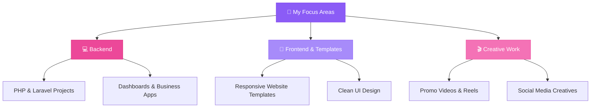

<div align="center">

# 👩‍💻 Janvi Lumbhani

### PHP & Laravel Web Developer · Webcare Infoway

*Building clean, responsive & modern websites · Creating website templates and business dashboards · Editing videos & social media content*

[LinkedIn](https://www.linkedin.com/in/janvi-lumbhani-1580ab2a9/) · [Instagram](https://www.instagram.com/iamjanvi_01_001) · [GitHub](https://github.com/CodeWithJanvi) · [Email](mailto:YOUR-EMAIL@gmail.com)

💼 **Freelance:** Open · 🤝 **Collaborations:** Open · 📚 **Learning:** Always

</div>

---

<div align="center">

### 🧭 Quick Navigation

[👋 About](#-about-me) · [💻 Tech Stack](#-tech-stack) · [🎨 What I Create](#-what-i-create) · [🚀 Projects](#-featured-projects) · [🌟 Interests](#-skills--interests) · [🌱 Roadmap](#-roadmap) · [📫 Connect](#-lets-connect)

</div>

---

## 👋 About Me

```php
<?php

class Janvi
{
    public string $name     = "Janvi Lumbhani";
    public string $role     = "PHP & Laravel Web Developer";
    public string $company  = "Webcare Infoway";

    public array $focus = [
        "💻 Building websites, dashboards and business applications",
        "🎨 Designing modern, responsive website templates",
        "🎬 Editing promotional videos, reels and social media content",
        "🚀 Turning ideas into clean digital experiences",
    ];

    public array $stack = [
        "backend"  => ["PHP", "Laravel", "MySQL"],
        "frontend" => ["JavaScript", "HTML5", "CSS3", "Bootstrap"],
        "tools"    => ["Git", "GitHub", "VS Code", "Postman"],
        "creative" => ["Website Templates", "Video Editing", "Social Media Creatives"],
    ];

    public string $openTo    = "Freelance projects & collaborations";
    public string $principle = "Clean · Responsive · User-friendly · Always improving";
}
```

<div align="center">

💼 Currently working at **Webcare Infoway** · 🌱 Always learning and building new projects

</div>

---

## 💻 Tech Stack

| Area | Technologies |
|---|---|
| **Backend** | PHP · Laravel · MySQL |
| **Frontend** | JavaScript · HTML5 · CSS3 · Bootstrap |
| **Tools** | Git · GitHub · VS Code · Postman · XAMPP |
| **Creative** | Website Templates · Video Editing · Social Media Creatives |

---

## 🎨 What I Create

| | Service | Description |
|:-:|---|---|
| 🌐 | **Websites** | Modern and responsive websites |
| 💻 | **PHP / Laravel Applications** | Business systems, dashboards and management applications |
| 🎨 | **Website Templates** | Creative landing pages and UI templates |
| 🎬 | **Video Editing** | Promotional videos, reels and social media content |
| 📱 | **Digital Content** | Social media creatives and promotional designs |

---

## 🚀 Featured Projects

<!-- ─────────────────────────────────────────────────────────────────
     HOW TO ADD A PROJECT:
     Copy one row from the table below and fill in:
       - Name (bold, with emoji)
       - One-line description
       - Tech        →  plain text, e.g. PHP · MySQL
       - Live Demo   →  [Visit](URL)  or  —
       - Source Code →  [Repo](URL)  or  🔒 Private
     Keep one row per project. Column order must match the header.
───────────────────────────────────────────────────────────────── -->

### 🌐 Web & Full-Stack

| Project | Description | Tech | Live Demo | Source |
|---|---|---|---|---|
| 🎁 **Rakhi Special Website** | A creative Raksha Bandhan website with an interactive experience. | HTML · CSS · JavaScript | [Visit](YOUR-LINK) | [Repo](YOUR-GITHUB-REPO) |
| 📊 **Business Dashboard** | A PHP/MySQL dashboard for managing business data and reports. | PHP · MySQL | — | [Repo](YOUR-GITHUB-REPO) |
| 🌐 **Website Templates** | Modern responsive website templates built with HTML, CSS and JavaScript. | HTML · CSS · JavaScript | [Visit](YOUR-LINK) | [Repo](YOUR-GITHUB-REPO) |

> 💡 *Projects built at Webcare Infoway belong to the company or its clients, so they are not listed here.*

---

## 🌟 Skills & Interests

<table>
  <tr>
    <td width="33%" valign="top">
      <h3>🎯 Currently Focused On</h3>
      - 💼 Working as a <strong>PHP / Laravel developer</strong><br>
      - 📊 Building <strong>dashboards & business apps</strong><br>
      - 🎨 Creating <strong>website templates</strong><br>
      - 🤝 Open to <strong>collaborations</strong><br>
      - 💻 Open to <strong>freelance projects</strong>
    </td>
    <td width="33%" valign="top">
      <h3>🎬 Beyond Code</h3>
      - 🎞️ <strong>Video Editing</strong> - promos & reels<br>
      - 📱 <strong>Social Media</strong> - creatives & content<br>
      - 🎨 <strong>Design</strong> - clean, modern layouts<br>
      - ✨ <strong>Creativity</strong> - ideas into visuals
    </td>
    <td width="33%" valign="top">
      <h3>🎓 Always Learning</h3>
      - 📚 Learning new tools & frameworks<br>
      - 🏗️ Building side projects<br>
      - 🔍 Improving code quality<br>
      - 🌱 Growing every day
    </td>
  </tr>
</table>

<div align="center">
  <em>Code + creativity = my kind of work 💖</em>
</div>

---

## 🌱 Roadmap

<!-- Edit the boxes below to match your real goals. -->



---

## 📫 Let's Connect

I'm open to:

- 🌐 Website Development
- 💻 PHP / Laravel Projects
- 🎨 Website Templates
- 🎬 Video Editing & Social Media Projects

<div align="center">

### 🤝 Let's Build Something Together

[LinkedIn](https://www.linkedin.com/in/janvi-lumbhani-1580ab2a9/) · [Instagram](https://www.instagram.com/iamjanvi_01_001) · [GitHub](https://github.com/CodeWithJanvi) · [Email](mailto:YOUR-EMAIL@gmail.com)

<br/>

### 🌟 *"Code with creativity, build with passion."*

**⭐ From [CodeWithJanvi](https://github.com/CodeWithJanvi) · Made with 💜 in Markdown**

</div>
